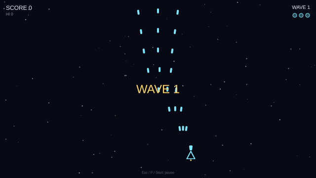

<p align="center">
  <picture>
    <source media="(prefers-color-scheme: dark)" srcset="assets/brand/logo/mark-ember-dark.svg">
    
  </picture>
</p>

# Cuervo Engine

[](https://github.com/Adan-Garcia/CuervoEngine/actions/workflows/ci.yml)
[](LICENSE.md)
[](https://adan-garcia.github.io/CuervoEngine/)

A 2D, vector-first, deterministic game engine in C++20 with its own statically typed
scripting language, **Pluma** (`.plm` files). The same inputs give the same game on every
thread count and backend, so replays, tests and networked play can check a single state hash.

<p align="center">
  
  <br><sub>The <code>examples/shmup</code> stage, captured headless and deterministically (the frames are the same on every run).</sub>
</p>

## Quickstart

```sh
cmake --preset release && cmake --build --preset release     # Linux; Windows and web: docs/WINDOWS.md, docs/WEB.md
./build/release/runtime/cuervo --game examples/shmup         # play the shmup (Z shoots, arrows move, Esc pauses)
./build/release/runtime/cuervo --game examples/tutorial      # Starfall, the game docs/GUIDE.md builds step by step
./build/release/editor/cuervo-editor --new-project mygame --template walker
./build/release/runtime/cuervo --game mygame                 # then edit mygame/scripts/*.plm while it runs (hot reload)
```

Next: the [guide](docs/GUIDE.md) (install, a first game, the editor, debugging, shipping),
[Pluma in five minutes](docs/PLUMA_GUIDE.md), the [API reference](docs/API.md) and the
[command-line reference](docs/CLI.md).

## How fast

Release build on a Ryzen 7 5800X3D with an RTX 3060 Ti, 1280x720, 4x MSAA, VSync off, 60 fps
target ([`docs/PERFORMANCE.md`](docs/PERFORMANCE.md) has the method, the debug builds, the web
and the spread):

| Workload | Vulkan | OpenGL |
|---|---|---|
| Particles drawn at 60 fps (dense scene) | 1.82 million | 1.51 million |
| Particles drawn at 60 fps (sparse scene) | 1.91 million | 1.55 million |
| Bullets also tested against hitboxes every tick, at 60 fps | 400 thousand | 400 thousand |
| 100k particles: frame time p95 | 0.65 ms | 0.85 ms |

Every number is a measurement of one machine and two scenes, not a promise: your game, GPU and
driver will differ. The state hash of each workload is identical across both backends and any
thread count.

## What is in it

Rendering on Vulkan and OpenGL (3.3, ES 3.0), WebGL2 and WebGPU backends in verified parity, with
render tiers (`render_tier` in `project.toml`) and a migration report; vector shapes, SVG
import, MSDF text, 2D lighting with shadows; sprites, sprite sheets, atlases and 9-slice;
post-processing (bloom, vignette, LUT, CRT), optional linear color and user shaders; the Pluma language and VM (with AOT compilation to
C), deterministic collections and math/geometry/random libraries; transform hierarchies and the
node library, particles, collision, audio, UI widgets; binary and text scenes, replays; localization,
text shaping and right-to-left container mirroring, and IME input in `LineEdit`; a save and settings API and a trace
profiler; lockstep and rollback netplay; the editor (scene tree, sprite and particle tooling);
and exporting for Linux, Windows and the web ([`docs/WEB.md`](docs/WEB.md), [`docs/WINDOWS.md`](docs/WINDOWS.md)).

**Status: Beta (v0.3).** Not everything above is equally finished: **what is shipped,
experimental, planned or unsupported is listed in [`docs/STATUS.md`](docs/STATUS.md)**, and that
page wins over this summary. Networking, the raster pipeline and text shaping are the newest
parts and carry the experimental label until they have had more use. The rest of the
documentation describes how things work.

<!-- support-matrix:begin summary -->
| Platform | Level |
|---|---|
| Linux x86-64, Vulkan 1.3 | Stable |
| Linux x86-64, OpenGL 3.3 core | Stable |
| Linux, OpenGL ES 3.0 (`--gl-es`) | Stable |
| Web (WebGPU or WebGL2 / WASM), Chrome | Stable |
| Web, WASM threads | Experimental |
| Web, Firefox and Safari | Experimental |
| Windows 10/11 x86-64 | Stable |
| macOS, iOS, Android, consoles | Unsupported |

57 features are classified (43 stable, 9 experimental, 4 planned, 1 unsupported). The `compatible` render tier runs everywhere; the `full` tier is desktop Vulkan only, and the tier check and the exporter refuse a project that claims more than its target provides. Details, per-feature platforms and the tier guarantees: [docs/STATUS.md](docs/STATUS.md).
<!-- support-matrix:end summary -->


## Documentation

The docs are a branded static site generated from the Markdown below (manual, Pluma guide, tutorial,
API reference, search, light and dark): `cmake --build build/debug --target docs_site`, then open
`build/debug/site/index.html`. Or without CMake: `python3 -I tools/build_site.py -o build/site --font ...`
(see the script's header). The pages in the repository:

- [docs/STATUS.md](docs/STATUS.md): the support matrix: shipped, experimental, planned and
  unsupported features, by platform, backend and system
- [docs/GUIDE.md](docs/GUIDE.md): **start here**: install, build, and make a small game step
  by step (the finished game is [examples/tutorial](examples/tutorial)), then hot reload,
  the editor, debugging and exporting
- [docs/CLI.md](docs/CLI.md): every flag of `cuervo` and `cuervo-tools` (generated from `--help`)
- [docs/API.md](docs/API.md): the engine API for scripts (generated from the prelude by
  `cuervo-tools docs`)
- [docs/PLUMA_GUIDE.md](docs/PLUMA_GUIDE.md): a guide to the Pluma language
- [docs/LANGUAGE.md](docs/LANGUAGE.md): the Pluma language reference
- [docs/SCENES.md](docs/SCENES.md): scene files and their text form
- [docs/REPLAYS.md](docs/REPLAYS.md): recording and verifying replays
- [docs/EXPORT.md](docs/EXPORT.md): packing and exporting games
- [docs/PACKAGES.md](docs/PACKAGES.md): Pluma packages, `import` and project dependencies
- [docs/PLUGINS.md](docs/PLUGINS.md): native plugins (C++, Rust, C#), the `@extern` FFI and the embedding API
- [docs/WEB.md](docs/WEB.md): building and serving WebGL2/WASM exports
- [docs/WINDOWS.md](docs/WINDOWS.md): building on Windows (MSVC, MinGW-w64, Clang), validation results and prebuilt binaries
- [docs/PERFORMANCE.md](docs/PERFORMANCE.md): performance baselines, the capacity test and regression thresholds
- [editor/README.md](editor/README.md): the editor
- [CONTRIBUTING.md](CONTRIBUTING.md): building from source, testing, and contribution guide
- [CODE_OF_CONDUCT.md](CODE_OF_CONDUCT.md) and [SECURITY.md](SECURITY.md): how we work together, and how to report vulnerabilities
- [docs/ROADMAP.md](docs/ROADMAP.md): the roadmap, generated from the milestones in DESIGN.md
- [tools/vscode-pluma](tools/vscode-pluma/README.md): the VS Code extension (highlighting,
  language server, debugger)
- [docs/DESIGN.md](docs/DESIGN.md): architecture, design decisions and the milestone list

## Requirements

- CMake ≥ 3.24 and Ninja
- GCC 13+ or Clang 17+
- `glslangValidator` (Khronos glslang; compiles the engine's shaders)
- SDL3 (optional: if it isn't installed, CMake fetches and builds it)
  - Arch: `sudo pacman -S cmake ninja glslang sdl3` (+ `vulkan-validation-layers` for debug builds)
  - Ubuntu 25.04+/Debian: `sudo apt install cmake ninja-build glslang-tools libsdl3-dev`
- Python 3 (stdlib only) for the documentation site and a few tests; Node 22+ and an
  emsdk (6.0.12) only for web builds
- A Vulkan 1.3 driver for the Vulkan backend (otherwise the runtime falls back to OpenGL)
- FreeType for font import (optional: if it isn't installed, CMake fetches and builds it;
  `-DCUERVO_FONT_IMPORT=OFF` drops font import and loads prebuilt `.efont` atlases only)
- Network access on first configure (fetches doctest, Vulkan headers, volk, VMA, SPIRV-Cross,
  libtess2, msdfgen, msdf-atlas-gen, Dear ImGui, and SDL3/FreeType if needed)

## License

Cuervo Engine is licensed under the [MIT License](LICENSE.md).
Third-party components keep their own licenses: [THIRD_PARTY_NOTICES.md](THIRD_PARTY_NOTICES.md)
and `third_party/licenses/`.

## Build and test

```sh
cmake --preset debug          # or: release
cmake --build --preset debug
ctest --preset debug
```

The editor is enabled in desktop builds by default. Feature switches include
`CUERVO_FEATURE_AUDIO`, `CUERVO_FEATURE_UI`, `CUERVO_FEATURE_PARTICLES`,
`CUERVO_FEATURE_COLLISION`, `CUERVO_FEATURE_DEV`, `CUERVO_PROFILING`, and
`CUERVO_TRACY`; see `CMakeLists.txt` and [`docs/EXPORT.md`](docs/EXPORT.md) for stripped
players and release builds.

## Run

```sh
./build/debug/runtime/cuervo --game examples/bench   # SDF shape stress test (Pluma); Space/Enter/Pad A cycles 1k/10k/50k/100k shapes, Esc quits
./build/debug/runtime/cuervo --game examples/bench --backend gl   # force a backend: vulkan | gl (default: Vulkan, falls back to GL)
./build/debug/runtime/cuervo --game examples/bench --quit-after 3 # exit after 3 seconds (smoke tests)
SDL_VIDEO_DRIVER=offscreen ./build/debug/runtime/cuervo --game examples/bench --quit-after 3   # headless (GL only: no headless Vulkan on NVIDIA)
./build/debug/runtime/cuervo --svg assets/test/clip.svg   # SVG viewer: wheel/+/- zoom, arrows pan, 0 resets
./build/debug/runtime/cuervo --svg in.svg --export out.evec  # import SVG to the binary ImportedVector format
./build/release/runtime/cuervo --game examples/bench --bench 10  # 50k animated SDF shapes, VSync off: logs frame-time stats (--bench works for any game)
./build/debug/runtime/cuervo --demo vector      # SVG character + MSDF text, zoom sweeps 1x..32x (--zoom Z fixes it)
./build/debug/runtime/cuervo --font in.ttf --export out.efont  # import a font to an MSDF atlas
./build/debug/runtime/cuervo --game examples/shmup  # the shmup stage, written in Pluma; edit its scripts while it runs (hot reload)
                                                 # title/pause/options/game-over menus (UI nodes + scene files); Esc/P pauses
./build/debug/runtime/cuervo --game examples/tutorial  # Starfall, the game docs/GUIDE.md builds
./build/debug/tools/cuervo_tools/cuervo-tools docs -o docs/API.md  # regenerate the API reference from the prelude
./build/debug/tools/cuervo_tools/cuervo-tools scene dump examples/shmup/scenes/title.scene  # scene file as text (docs/SCENES.md)
./build/debug/runtime/cuervo --game examples/shmup --backend gl --gl-es  # GL backend on an OpenGL ES 3.0 context (WebGL2's API)
./build/debug/runtime/cuervo --game examples/shmup --jobs 4  # job system threads (or CUERVO_JOBS / project.toml `jobs`); same result for any count
./build/debug/tools/cuervo_tools/cuervo-tools tier check examples/shmup [--to full]  # render-tier migration report
./build/debug/tools/rhi_parity/rhi_parity features --backend vulkan  # device capabilities and tiers
./build/debug/editor/cuervo-editor --project examples/editor_level  # the editor (editor/README.md): scene tree, view, inspector, undo
./build/debug/editor/cuervo-editor --new-project mygame --template walker  # a new project (no window); then --project mygame, cuervo --game mygame, cuervo-tools export mygame
./build/debug/editor/cuervo-editor --project examples/shmup     # F5 plays the game in the editor; replays: docs/REPLAYS.md
./build/debug/runtime/cuervo --game examples/editor_level  # a level built in the editor without code (examples/editor_level/level.cmds)
./build/debug/runtime/cuervo --game examples/netduel --net-host 7777   # two players: run the same game with --net-join host:7777 on the other machine
./build/release/runtime/cuervo --game examples/shmup --trace trace.json --quit-after 10   # Chrome trace for ui.perfetto.dev (--profile logs tables)
./build/debug/pluma/plm      # Pluma REPL: type code, see the results
```

## Examples

| Directory | What it is |
|---|---|
| `examples/shmup` | the shmup stage: waves, a boss, title/pause/options/game-over menus, audio |
| `examples/tutorial` | Starfall, the game [`docs/GUIDE.md`](docs/GUIDE.md) builds step by step |
| `examples/tictak` | a board game with mouse input |
| `examples/lantern_cave` | a physics platformer lit by 2D lights, tiles and animated characters |
| `examples/netduel` | two players over the network (`--net-host`, `--net-join`, `--net-relay`) |
| `examples/platformer`, `examples/topdown_nav`, `examples/anim_character` | physics, navigation and animation |
| `examples/garden`, `examples/plugin_demo` | packages and native plugins (C++, Rust, C#) |
| `examples/bench`, `examples/bench_spread`, `examples/bench_collide` | the SDF shape stress test (1k to 100k shapes) |
| `examples/editor_level` | a level built in the editor without code |
| `examples/node_level` | a level using every built-in node, with no scripts |
| `examples/ui_menus` | a settings and inventory menu from the UI widgets |

## Web build

See [`docs/WEB.md`](docs/WEB.md): `cmake --preset host-tools && cmake --build --preset host-tools`,
then with emsdk 6.0.12 active `cmake --preset web && cmake --build --preset web`, serve
`build/web/runtime/` and open `index.html`; `node tools/web/smoke_test.mjs` checks it headlessly.
The `web-threads` and `web-pack-threads` presets build the opt-in WASM-threads variants.

## Layout

```
cmake/      compiler flags (determinism: no fast-math, no FMA contraction) and dependencies
cuervo/
  core/     logging, fixed-timestep loop, PCG32 RNG, profiling, interned names
  math/     Vec<T,N>, affine transforms, deterministic math (dmath)
  platform/ SDL3 window + event pump, frame loop (web-drivable), file watcher, platform helpers
  input/    device state, action/axis map, recordable/replayable input frames
  rhi/      render hardware interface; vulkan/ and gl/ backends
  render/   camera, SDF and mesh batchers, MSDF fonts/text, shaders
  vector/   SVG import, flattening, tessellation, stroking, ImportedVector format
  scene/    binary scenes, node hierarchy and scene editing
  particles/ deterministic CPU and visual particle systems
  collision/ collision world and spatial queries
  audio/    miniaudio mixer and sound playback
  jobs/     deterministic job-system integration
  script/   project loading, VM host, bindings and engine prelude
pluma/      Pluma language library (lexer, parser, checker, VM, AOT) + repl/ (`plm`) — never depends on cuervo/
runtime/    player executable (`cuervo`)
editor/     the editor (`cuervo-editor`, RmlUi on the RHI; desktop only; the deprecated ImGui editor is behind `--imgui`)
tools/      cuervo-tools (pack/export, scenes, tiers, LSP, API docs), the docs-site generator,
            shader_tool, rhi_parity, web smoke test, the VS Code extension
web/        the web shell page and pack loader
examples/   the example projects (above)
assets/     brand assets, the default font
tests/      doctest suites (cuervo_tests, pluma_tests, editor_tests) and end-to-end ctest scripts
docs/       documentation (this list), the design, and the support status
```
